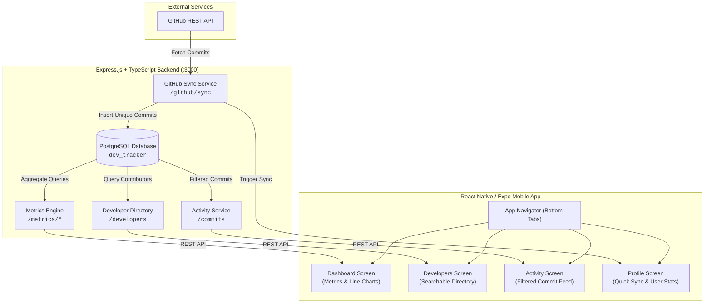

# 🚀 Developer Productivity Tracker

<p align="center">
  <strong>An open-source full-stack platform that transforms raw GitHub repository activity into actionable engineering metrics, interactive velocity charts, and developer leaderboards.</strong>
</p>

<p align="center">
  <a href="#-features"></a>
  <a href="LICENSE"></a>
  <a href="https://www.typescriptlang.org/"></a>
  <a href="https://nodejs.org/"></a>
  <a href="https://reactnative.dev/"></a>
  <a href="https://expo.dev/"></a>
  <a href="https://www.postgresql.org/"></a>
</p>

<p align="center">
  <a href="#-key-features">Key Features</a> •
  <a href="#-architecture--data-flow">Architecture</a> •
  <a href="#-tech-stack">Tech Stack</a> •
  <a href="#-project-structure">Project Structure</a> •
  <a href="#-quick-start">Quick Start</a> •
  <a href="#-api-documentation">API Reference</a> •
  <a href="#-contributing">Contributing</a> •
  <a href="#-license">License</a>
</p>

---

## 📖 Overview

**Developer Productivity Tracker** is a modular, enterprise-ready monorepo designed to track, aggregate, and visualize developer performance. Built with a high-performance **Express.js & TypeScript** backend backed by **PostgreSQL**, and an intuitive **React Native (Expo)** mobile frontend, this application provides engineering managers, team leads, and developers with clear visibility into code velocity and contribution history.

### Why Developer Productivity Tracker?

- 🔍 **Eliminate Blind Spots**: Gain instant visibility into repository contribution cadence.
- 📈 **Visualize Team Velocity**: Identify trends with interactive commit history charts.
- 🏆 **Motivate Contributors**: Foster healthy engineering competition with transparent productivity scoring.
- 📱 **Mobile-First Experience**: Monitor your team's code health on-the-go from iOS, Android, or Web.

---

## ✨ Key Features

- **📊 Interactive Metrics & Velocity Trends**: Dynamic Bezier line charts visualizing daily commit frequency over time.
- **🏆 Gamified Productivity Leaderboard**: Automatic calculation of developer productivity scores based on contribution activity.
- **🔄 GitHub REST API Ingestion**: One-click sync engine that pulls commits, messages, and authors directly into PostgreSQL.
- **👥 Contributor Explorer**: Searchable directory of contributors with individual commit tallies and avatar placeholders.
- **⏱️ Activity Timeline**: Filter commit histories by timeframe (`7 Days`, `30 Days`, `All Time`) with relative time-ago timestamps.
- **🌓 Adaptive Theme**: Seamless integration with device Dark Mode and Light Mode settings.
- **🏛️ Strict Clean Architecture**: Feature-scoped modules, strict separation of concerns, and zero `any` tolerance.

---

## 🏗️ Architecture & Data Flow



---

## 🛠️ Tech Stack

| Layer | Technologies | Description |
|---|---|---|
| **Mobile App** | React Native `0.81`, Expo SDK `54`, TypeScript | Cross-platform client for iOS, Android, and Web |
| **Mobile Navigation** | React Navigation `v7` | Native Stack + Bottom Tabs architecture |
| **Mobile UI & Charts**| React Native Chart Kit, SVG, Vector Icons | Native charts and responsive layouts |
| **Backend API** | Express.js `v5`, Node.js, TypeScript | Clean modular REST API |
| **Database** | PostgreSQL `14+`, `pg` (node-postgres) | Relational persistence with indexed aggregations |
| **HTTP Clients** | Axios | Network clients with interceptors and timeout controls |
| **Code Quality** | ESLint, TypeScript Strict Mode | Zero-tolerance for unsafe typings or implicit `any` |

---

## 📁 Project Structure

```
dev-productivity-tracker/
├── backend/                         # Express.js REST API
│   ├── src/
│   │   ├── config/                  # DB pool configuration & SQL init scripts
│   │   ├── middleware/              # Error handling & HTTP logger middleware
│   │   ├── modules/                 # Modular feature controllers & services
│   │   │   ├── developer/           # Contributor listing & stats
│   │   │   ├── github/              # GitHub REST API sync engine
│   │   │   └── metrics/             # Aggregate metrics, trends & leaderboard
│   │   ├── services/                # Axios instance for GitHub API
│   │   ├── shared/                  # DTOs, route constants & configuration
│   │   ├── app.ts                   # Express application setup
│   │   └── server.ts                # Server entry point
│   ├── .env.example                 # Environment configuration template
│   ├── package.json
│   └── tsconfig.json
│
├── mobile/                          # React Native (Expo) Client
│   ├── src/
│   │   ├── modules/                 # Feature-based modular screens
│   │   │   ├── activity/            # Commit activity feed & filtering
│   │   │   ├── dashboard/           # Summary cards, charts & leaderboard
│   │   │   ├── developers/          # Contributor search & metrics
│   │   │   └── profile/             # Profile overview & sync trigger
│   │   ├── navigation/              # App navigator & tab bar configuration
│   │   ├── services/                # Axios client targeting backend API
│   │   └── shared/                  # Context providers, hooks & utilities
│   ├── App.tsx                      # Root component with ThemeProvider
│   ├── app.json                     # Expo configuration
│   ├── package.json
│   └── tsconfig.json
│
├── rules/                           # Architecture & coding standards
│   ├── rules.md                     # Strict engineering enforcement rules
│   └── skills.md                    # Technical workflow guidelines
├── .gitignore
├── CONTRIBUTING.md                  # Contribution guidelines
├── LICENSE                          # MIT License
└── README.md                        # Documentation
```

---

## ⚡ Quick Start

### 1. Prerequisites

Ensure you have the following installed on your machine:
- [Node.js](https://nodejs.org/) (`v18` or `v20` recommended)
- [PostgreSQL](https://www.postgresql.org/) (`v14` or later)
- [Expo Go](https://expo.dev/go) on your mobile device (or Android Studio / Xcode emulators)
- A [GitHub Personal Access Token](https://github.com/settings/tokens) with `repo` read access

---

### 2. Clone the Repository

```bash
git clone https://github.com/<your-username>/dev-productivity-tracker.git
cd dev-productivity-tracker
```

---

### 3. Database Setup

1. Start your PostgreSQL service.
2. Create a new database named `dev_tracker`:
   ```sql
   CREATE DATABASE dev_tracker;
   ```
3. Initialize the schema using the provided SQL script:
   ```bash
   psql -U postgres -d dev_tracker -f backend/src/config/init.sql
   ```
   *(Alternatively, run the queries in `backend/src/config/init.sql` using pgAdmin or DBeaver).*

---

### 4. Backend Setup

1. Navigate to the backend directory and install dependencies:
   ```bash
   cd backend
   npm install
   ```

2. Create your `.env` file from the provided template:
   ```bash
   cp .env.example .env
   ```

3. Configure your `.env` variables:
   ```env
   PORT=3000
   GITHUB_TOKEN=your_github_personal_access_token_here
   GITHUB_OWNER=octocat
   GITHUB_REPO=Hello-World
   DB_HOST=localhost
   DB_PORT=5432
   DB_USER=postgres
   DB_PASSWORD=your_postgres_password
   DB_NAME=dev_tracker
   ```

4. Start the backend development server:
   ```bash
   npm run dev
   ```
   The backend will start on `http://localhost:3000`.

---

### 5. Mobile App Setup

1. In a new terminal, navigate to the `mobile` directory and install dependencies:
   ```bash
   cd mobile
   npm install
   ```

2. **Configure the Backend API URL**:
   Open [`mobile/src/services/apiClient.ts`](mobile/src/services/apiClient.ts) and set `baseURL`:
   - **Physical Device (Expo Go)**: Use your computer's local network IP address (e.g. `http://192.168.1.15:3000`).
   - **Android Emulator**: Use `http://10.0.2.2:3000`.
   - **iOS Simulator / Web**: Use `http://localhost:3000`.

3. Start Expo:
   ```bash
   npx expo start
   ```

4. Scan the QR code with **Expo Go** (Android/iOS) or press `a` for Android Emulator / `i` for iOS Simulator / `w` for Web.

---

## 📡 API Reference

All endpoints return JSON responses.

### 1. Synchronize GitHub Commits
Fetches commits from the configured GitHub repository and persists unique commits into the database.

- **URL**: `/github/sync`
- **Method**: `GET`
- **Response `200 OK`**:
  ```json
  [
    {
      "sha": "a1b2c3d4e5f6...",
      "message": "feat: implement leaderboard score formula",
      "authorName": "Jane Doe",
      "authorEmail": "jane@example.com",
      "commitDate": "2026-10-12T14:32:00Z"
    }
  ]
  ```

### 2. Get Contributor Directory
Returns list of all contributors with their total commit count.

- **URL**: `/developers`
- **Method**: `GET`
- **Response `200 OK`**:
  ```json
  [
    {
      "id": "jane@example.com",
      "authorName": "Jane Doe",
      "authorEmail": "jane@example.com",
      "commitCount": 42
    }
  ]
  ```

### 3. Get Metrics Summary
Returns aggregate repository commit metrics and the top contributor.

- **URL**: `/metrics/summary`
- **Method**: `GET`
- **Response `200 OK`**:
  ```json
  {
    "totalCommits": 128,
    "topContributor": {
      "authorName": "Jane Doe",
      "authorEmail": "jane@example.com",
      "commitCount": 42
    },
    "developerStats": [
      {
        "authorName": "Jane Doe",
        "authorEmail": "jane@example.com",
        "commitCount": 42
      }
    ]
  }
  ```

### 4. Get Commit Velocity Trends
Returns daily commit volume for charting and trend analysis.

- **URL**: `/metrics/trends`
- **Method**: `GET`
- **Response `200 OK`**:
  ```json
  [
    { "date": "2026-10-10", "count": 14 },
    { "date": "2026-10-11", "count": 22 },
    { "date": "2026-10-12", "count": 18 }
  ]
  ```

### 5. Get Developer Leaderboard
Returns contributors sorted by productivity score (calculated from contribution frequency).

- **URL**: `/metrics/leaderboard`
- **Method**: `GET`
- **Response `200 OK`**:
  ```json
  [
    {
      "authorName": "Jane Doe",
      "authorEmail": "jane@example.com",
      "commitCount": 42,
      "productivityScore": 420
    }
  ]
  ```

### 6. Get Activity Feed
Returns paginated/filtered list of recent commits.

- **URL**: `/commits/recent`
- **Method**: `GET`
- **Query Parameters**:
  - `days` *(optional, number)*: Filter commits within the last `N` days (e.g. `?days=7` or `?days=30`).
- **Response `200 OK`**:
  ```json
  [
    {
      "id": "a1b2c3d4e5f6...",
      "author": "Jane Doe",
      "email": "jane@example.com",
      "message": "fix: correct timestamp offset",
      "date": "2026-10-12T14:32:00Z"
    }
  ]
  ```

---

## ⚙️ Environment Variables

The backend relies on the following environment variables (stored in `backend/.env`):

| Variable | Required | Default / Example | Description |
|---|---|---|---|
| `PORT` | Optional | `3000` | Port for the Express.js server |
| `GITHUB_TOKEN` | **Required** | `None` | GitHub Personal Access Token with repo read scope |
| `GITHUB_OWNER` | **Required** | `octocat` *(example)* | Target repository owner or organization |
| `GITHUB_REPO` | **Required** | `Hello-World` *(example)* | Target repository name |
| `DB_HOST` | Optional | `localhost` | PostgreSQL host address |
| `DB_PORT` | Optional | `5432` | PostgreSQL port |
| `DB_USER` | Optional | `postgres` | PostgreSQL username |
| `DB_PASSWORD` | Optional | `root` | PostgreSQL password |
| `DB_NAME` | Optional | `dev_tracker` | PostgreSQL database name |

---

## 📐 Engineering Standards & Architecture Rules

This project enforces strict software engineering standards (documented in [`rules/rules.md`](rules/rules.md)):

- **Zero-Tolerance TypeScript**:
  - Strict mode enabled (`"strict": true`, `"noImplicitAny": true`).
  - No `any`, `unknown`, `@ts-ignore`, or `@ts-expect-error` allowed.
- **Strict Modularity**:
  - Feature-scoped modules (`modules/` contains screen, hooks, services, types, and styles together).
  - Cross-module direct dependencies are forbidden; shared logic belongs exclusively in `shared/`.
- **Pure Native State Management**:
  - Only built-in React primitives (`useState`, `useReducer`, `useContext`) are allowed.
  - No external state bloat (Redux, Zustand, MobX).
- **Type-Safe Domain Constants**:
  - All statuses, action types, and string constants must be typed with domain constants (`as const`).

---

## 🗺️ Roadmap

- [ ] **Docker & Docker Compose**: Single-command setup for PostgreSQL, Backend, and Web client.
- [ ] **Multi-Repository Tracking**: Track multiple repositories and organizations simultaneously.
- [ ] **Pull Request & Code Review Analytics**: PR turnaround time, review participation, and merge rates.
- [ ] **Custom Scoring Algorithms**: Configurable scoring weights (lines changed, PR merges, reviews).
- [ ] **Automated GitHub Webhooks**: Real-time event ingestion instead of polling sync.
- [ ] **Role-Based Authentication**: GitHub OAuth 2.0 login and team management.

---

## 🤝 Contributing

Contributions are what make the open-source community an incredible place to learn, inspire, and create. Any contributions you make are **greatly appreciated**!

Please read our [**Contributing Guide (CONTRIBUTING.md)**](CONTRIBUTING.md) for details on code standards, branch conventions, and the pull request process.

1. Fork the Project
2. Create your Feature Branch (`git checkout -b feat/AmazingFeature`)
3. Commit your Changes (`git commit -m 'feat: add AmazingFeature'`)
4. Push to the Branch (`git push origin feat/AmazingFeature`)
5. Open a Pull Request

---

## 📄 License

Distributed under the **MIT License**. See [`LICENSE`](LICENSE) for more information.

---

## 💬 Community & Support

- **Found a bug or have a feature request?** Open an [Issue](../../issues).
- **Enjoying the project?** Give it a ⭐️ on GitHub to support development!

